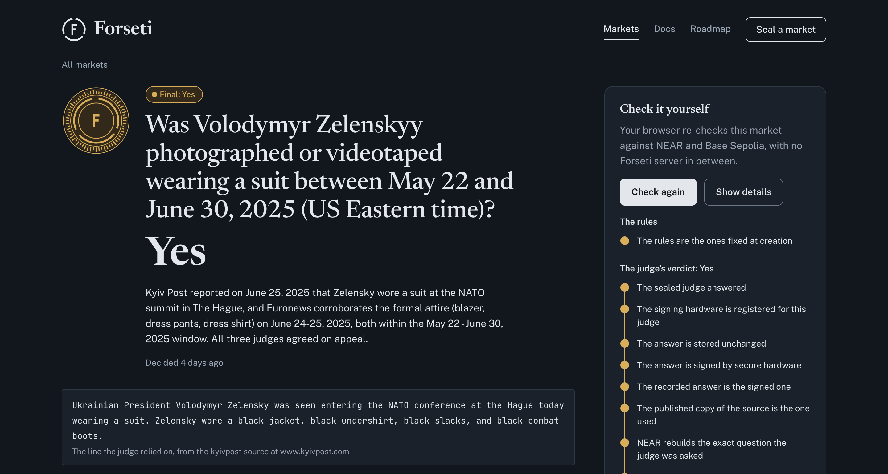
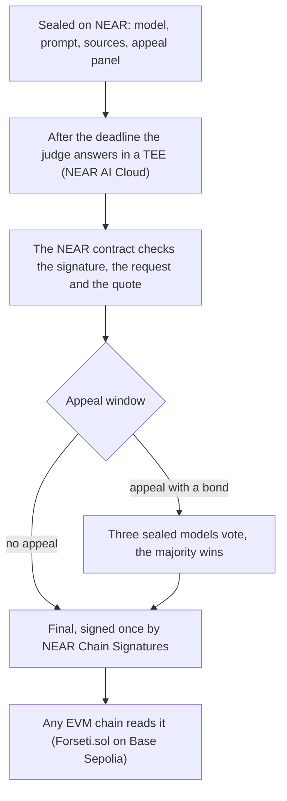
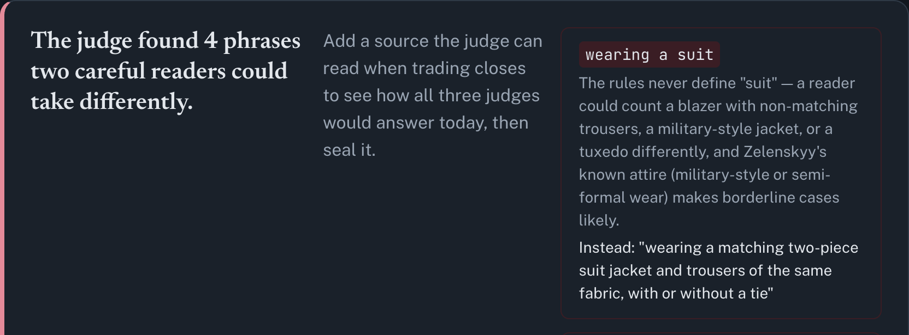

# Forseti

A judge for prediction markets that is fixed before trading starts and checked on NEAR.

**Live:** https://www.forsetihq.xyz · **Try it in 5 minutes, no wallet:** https://www.forsetihq.xyz/#/new ·
**X:** [@forsetihq](https://x.com/forsetihq)

[](https://www.forsetihq.xyz/#/m/4)

*Market 4 replays Polymarket's $242M market "Will Zelenskyy wear a suit before July?", which UMA token
holders resolved No. Forseti's sealed judge answered Yes from the Kyiv Post's report, the three appeal judges
agreed, and the browser re-runs all 39 checks against NEAR and Base Sepolia. A replay reads today's copies
of its sources, so it shows how a sealed judge reads the evidence, not what it would have said on the day.*

A market commits to a model, a system prompt, its sources and a three-model appeal panel. After the
event deadline the NEAR contract builds the exact request for the model, verifies the NEAR AI Cloud
TEE signature over that request and the answer, and checks that the quoted evidence is in the source
snapshot. The final verdict is signed once through Chain Signatures, and any EVM chain verifies it with
`ecrecover`.

Built at NEAR HACKATHON (Nov 1–14, 2026). Everything below runs today on NEAR testnet and Base Sepolia.

Docs: [overview](docs/overview.md), [integrate Forseti into a market](docs/integrate.md),
[write a market](docs/write-a-market.md), [how a verdict is checked](docs/verification.md),
[reference](docs/reference.md) and the [roadmap](docs/roadmap.md). The web page shows the same files
under **Docs** and **Roadmap**.

## Problem

Crypto prediction markets such as Polymarket settle disputes with token votes (UMA): the holders who vote
can also trade on the same platform. Models can already settle most of these questions, but traders need
to know in advance which model will judge, on what sources, and be able to check afterwards that it really
did.

## How it works



1. `create_market` stores the commitment: question, rules, model, system prompt, sources, seed, panel,
   deadlines, appeal bond. `commitment_hash = sha256(commitment JSON)` keys the market on other chains.
2. Before the deadline, anyone can "ask the judge": `submit_preview` records a signed, non-binding answer.
3. After the deadline, `open_round` draws a nonce from the block's random seed.
4. The executor fetches the sources, gets the exact request bytes from the `build_request` view, sends them
   to NEAR AI Cloud and fetches the ed25519 signature over `model:sha256(request):sha256(response)`.
5. `submit_ruling` rebuilds the request, checks the signature against the model's registered TEE keys,
   parses the answer and checks that the quote is in the cited snapshot.
6. During the challenge period, an appeal (with a bond) or a second signed answer with a different outcome
   sends the market to the committed panel. A TOO_EARLY answer is proposed like any other; if nobody
   challenges it, anyone opens a new round.
7. The panel votes for one more challenge period, each model with the nonce `<round nonce>:panel`. A
   second signed vote for a seat with a different outcome contests it, and a contested seat counts as
   INVALID. After the window the majority decides.
8. `finalize` settles the outcome (YES=1, NO=2, INVALID=3) and asks the MPC signer for an ECDSA signature
   over one EIP-712 digest: domain `{name:"Forseti", version:"1"}`, no chainId,
   `Verdict(bytes32 commitmentHash,uint8 outcome,uint32 round)`.
9. Anyone relays the signature to `Forseti.sol` on an EVM chain. `DemoMarkets.sol` pays out from it.

## Try it in the browser: about 5 minutes, no wallet or key

Open https://forsetihq.xyz/#/new.

1. Paste `https://polymarket.com/event/will-zelenskyy-wear-a-suit-before-july` into **Start from a
   Polymarket market**, click **Load**, then **Check the wording**. The form fills with Polymarket's own
   question and rules, read from Polymarket's public API in your browser. In about 10 seconds the judge
   lists the phrases two careful readers could take differently, each with a precise replacement. In our
   runs it flagged "wearing a suit" first: the phrase this $242M market was disputed over. Polymarket
   names no source for this market ("a consensus of credible reporting"), so only the wording is checked;
   add a source to see the judges answer it and to seal it. An event with several markets, such as
   `https://polymarket.com/event/fed-decision-in-december-20260729232808632`, lets you pick one.

   

   A market sealed from Polymarket keeps the link in its sealed rules, and its page shows Polymarket's
   result, read live, next to Forseti's: market 40 is the suit market with a Euronews report as its
   source. A market that is still open on Polymarket closes here when it closes there: market 42, on AAA's
   gas price, closed at 15:00 UTC on Nov 10. The judge answered No from AAA's page at the close, and the
   verdict was final and on Base Sepolia minutes later, while Polymarket still showed the market open.
2. Click **A vague one, on purpose**, then **Check the wording**. In about half a minute you see:
   - the judge's notes on the words two honest readers could take differently ("cold", "the weather in
     Berlin"), each with a precise replacement;
   - how the judge and both other panel models read today's source.

   Each answer is signed in NEAR AI Cloud's TEE. Your browser checks every signature against the keys
   registered on `forseti.testnet`. It also checks whether each quote is word for word in the source, the
   same check the contract runs on-chain.
3. Click **A fact on Wikipedia**, **Check the wording**, then **Seal it on NEAR**. A demo account,
   `forseti-relay.testnet`, creates the market and pays the 2 NEAR storage deposit. You land on the new
   market's page.
4. Watch **Live on testnet**:
   - trading closes 2 minutes after sealing;
   - the sealed judge answers on secure hardware, and NEAR accepts the signed answer;
   - a 2-minute appeal window runs;
   - the verdict becomes final, NEAR Chain Signatures signs it, and Base Sepolia records it.

   When it is done, the page runs **Check it yourself** on its own, and every check passes in your browser.
   Markets 31, 32 and 39 went through these steps on Nov 9.

The site's server is a set of Vercel functions in `api/`: `check`, `create` and `advance`.
- **Not trusted.** It is one more executor that pays gas and model fees. The contract re-checks everything
  it submits.
- **What it moves.** Only markets created by its relay account or by `forseti.testnet`.
- **Limits.** At most 6 visitor markets per hour, plus a per-visitor rate limit.

**Markets 33–35 resolve during judging** (Nov 16–18 UTC), on the Coinbase daily candles of ETH, NEAR and
BTC. cron-job.org calls `/api/advance?all=1` every 5 minutes, so they settle with nobody at a keyboard;
each call leaves one line in the Vercel logs. A scheduled GitHub Action (`.github/workflows/advance.yml`)
calls it too, as a backup: GitHub runs it only a few times a day. On the site they are under
**Markets → Deciding live**.

## Try it locally

Requirements: Rust (the toolchain in `contract/rust-toolchain.toml` installs itself through rustup),
Foundry, Node 20.6+. Steps 1–3 and the browser checks need no keys; steps 4–5 and **Ask the judge** need a
NEAR AI Cloud key.

1. Run `cd contract && cargo test`. You see 28 passing tests: the happy path (preview, verdict, finalize),
   rejection of a tampered response, a key of another model, an answer signed for other snapshots, a quote
   that is not in the snapshot or too short to be evidence, and a snapshot that tries to escape its
   `<source>` tag in any case or spacing; the panel, appeal, TOO_EARLY and expiry paths; and one test per
   attack found in our audit: a proposal replayed as a panel vote, a dispute settled inside the panel's
   window, a forged panel majority (contested seats make it INVALID), a stalling TOO_EARLY, a verdict after
   `resolve_by` and a replayed preview.
2. Run `cd evm && forge test`. You see 15 passing tests: the verifier accepts the MPC signature (recovery
   id 0/1 or 27/28), rejects a changed outcome, another signer and a second write, and the demo market pays
   winners or refunds on INVALID, refuses bets once a verdict exists and markets opened by anyone but the
   operator, and refunds stakes 7 days after the close when no verdict arrives.
3. Both test suites assert the same EIP-712 digest vector, produced independently with viem's
   `hashTypedData`, so the NEAR contract and the EVM verifier agree on the bytes that get signed.
4. With a NEAR AI Cloud key in `.env` (copy `.env.example`), run `cd executor && npm i && npm run probe`.
   It fetches a model attestation with a fresh nonce, sends one completion and checks the model id, both
   hashes and the ed25519 signature.
5. Run `node --env-file=../.env attest.mjs` in `executor/`. For each panel model you see the checks behind
   its signing key: Intel TDX quote valid (dcap-qvl), `report_data` binds the key and our fresh nonce, the
   docker compose hash matches `mr_config`, and the NVIDIA NRAS verdict (shown as SKIP when NVIDIA blocks
   your network). `--register` adds keys with no failed check, and refuses a key whose NVIDIA check was
   skipped unless you add `--allow-gpu-skip`. The three keys registered today were registered with the
   NVIDIA check skipped, because NVIDIA's service refused our network.

### Verify in the browser

The web page (`web/`, no build step) reads the markets from NEAR and re-runs every check in your
browser; only **Seal a market** uses the server functions in `api/`. It uses the Forseti design system
in `web/design/`: every market has a seal drawn from its commitment hash, and the page shows the answer
first, how it was decided second, and the technical details under **For auditors**.

1. From the repository root run `python3 -m http.server 5173 --bind 127.0.0.1` and open
   `http://localhost:5173/web/`. Keep the `--bind`: the server shares the whole folder, including your
   `.env`, and without it anyone on your network could read it.
   You see the overview: what Forseti does, how a market goes from sealed to final, what is checked and
   what is still trusted, live numbers read from the contract, and the story of market 3. Click
   **Verify** and you see the register of markets on `forseti.testnet`, each with its seal
   and status.
2. Open market 1 and click **Check it yourself**. You see 47 checks fill in one by one and end with
   "All 47 checks passed in your browser". Click **Show details** for the exact values. They cover the
   terms' hash against the commitment, and for each preview, verdict and panel vote: that the sealed model
   (or the model sealed for that panel seat) answered, its key in the on-chain registry, the response hash,
   the ed25519 TEE signature, that the recorded outcome, source, quote and reason are the signed ones, the
   published snapshots against their on-chain hashes, the request rebuilt by NEAR (`rebuild_request`)
   against the signed hash, and the quote in the snapshot. Then the final outcome is recomputed from the
   record, and come the EIP-712 digest, the MPC signer derived from `forseti.testnet`, `signer()` and
   `verdictOf` on Base Sepolia. A check the network could not answer shows as not checked, never as passed.
3. Open market 2 (deadline 20 Nov 2026) and use **Ask the judge** with your own NEAR AI Cloud key. The
   browser fetches the committed source, gets the exact request from the contract, asks
   `z-ai/glm-5.3-flash` and checks the TEE signature. Today it answers TOO_EARLY, as its rules require.

### Live on NEAR testnet

The contract runs at [`forseti.testnet`](https://testnet.nearblocks.io/address/forseti.testnet). Its
Chain Signatures EVM signer (path `verdict-v1`) is `0xD5f2B07870279Fd733eDadFB1e49b9Fe1f3e26e8`.

On Base Sepolia (deployed with `evm/deploy.sh`):
- `Forseti.sol` verifier: [`0x374541e22a7406E8246D0774E8994fc358232121`](https://sepolia.basescan.org/address/0x374541e22a7406E8246D0774E8994fc358232121), `signer()` returns the address above
- `DemoMarkets.sol` v2: [`0x42297B4CddeC88CcF1aC989865Fd8e29570b3711`](https://sepolia.basescan.org/address/0x42297B4CddeC88CcF1aC989865Fd8e29570b3711) (only the operator opens markets, no bets once a verdict exists, refunds 7 days after the close without a verdict)
- `DemoMarkets.sol` v1, retired: [`0x9E6edEA194B835c6D100968FF5E8d5eaac3C8692`](https://sepolia.basescan.org/address/0x9E6edEA194B835c6D100968FF5E8d5eaac3C8692). It holds the bets of markets 1 and 3 below; our audit found it accepted bets after the verdict was known, so v2 replaced it.

The executor (`executor/forseti.mjs`) drives a market end to end. Each step saves a proof bundle in
`executor/proofs/`: sources, snapshots, the exact request and response, the TEE signature and the tx.

```
node --env-file=../.env forseti.mjs create markets/berlin.json   # commit the judge, 2 NEAR deposit
node --env-file=../.env forseti.mjs preview <id>                 # "ask the judge" before the deadline
node --env-file=../.env forseti.mjs resolve <id>                 # after the deadline: round + verdict
node --env-file=../.env forseti.mjs appeal <id>                  # optional: bond -> panel
node --env-file=../.env forseti.mjs panel <id>                   # the three panel models vote
node --env-file=../.env forseti.mjs finalize <id>                # settle + MPC signature for EVM
node --env-file=../.env verify-evm.mjs <id>                      # recover the signer like an EVM chain
node --env-file=../.env relay.mjs <id> <Forseti.sol> [rpc]       # submit the verdict on an EVM chain
node --env-file=../.env bets.mjs open|bet|status|claim <id> ...  # demo bets on Base Sepolia
```

Recorded run, market 0 ("Is the current air temperature in Berlin above 0 °C according to Open-Meteo?"),
Nov 6 2026. Open any transaction on testnet.nearblocks.io to see the arguments and the contract's events:

| Step | Transaction | What the contract checked |
|---|---|---|
| Ask the judge (preview) | [`CnkJPPdx…`](https://testnet.nearblocks.io/txns/CnkJPPdxDP6sxZnBNcz7wZQPQDktLqz6UYvXAsLM95DN) | request rebuilt on-chain, ed25519 TEE signature of glm-5.3-flash, quote `"temperature_2m":6.1` found in the snapshot |
| Open round | [`2eS9B8Cc…`](https://testnet.nearblocks.io/txns/2eS9B8CcSFpLC7rbxRF21HfSayzi43tXMogda8KEMRaj) | deadline passed, nonce drawn from the block's random seed |
| Verdict YES | [`2nfcusbh…`](https://testnet.nearblocks.io/txns/2nfcusbhQtk1kmE67ioih56FbSWFTXq9yaWrPubxZgfF) | same checks, with the round nonce inside the signed request |
| Finalize + MPC signature | [`2Yib5c8w…`](https://testnet.nearblocks.io/txns/2Yib5c8wqrhwGEUnvSZs4oY25bpLxgE2wxRde1hdQimD) | challenge period over; `v1.signer-prod.testnet` signed digest `0xcb44c710…631e` |

`verify-evm.mjs 0` recovers `0xD5f2B07870279Fd733eDadFB1e49b9Fe1f3e26e8` from that signature. `relay.mjs`
then recorded the verdict on Base Sepolia:
[`0xafea4cdc…`](https://sepolia.basescan.org/tx/0xafea4cdc4283ffebd109f7b30bc2a4785f64631cb439a0cdd53d7026c042bdc6).
To check it yourself, run
`cast call 0x374541e22a7406E8246D0774E8994fc358232121 "verdictOf(bytes32)((uint8,uint32))" 0xe2d9227ac516e8a0e766344d21542b4365786c48fb354b3980061eefe25bd1ef --rpc-url https://sepolia.base.org`.
You see `(1, 1)`: YES, round 1. The proof bundles are in `executor/proofs/`.

Recorded run with an appeal and bets, market 1 ("… above 5 °C …"), Nov 6 2026:

| Step | Transaction | Result |
|---|---|---|
| Two wallets bet on Base Sepolia (`executor/bets.mjs`) | [YES 0.002 ETH](https://sepolia.basescan.org/tx/0x9ec4d1a3eeef30249425274e98c2d053b1c8e2b59c28655021f2a7abc1ee15a4), [NO 0.001 ETH](https://sepolia.basescan.org/tx/0xb1423657b0428939649ec0e670fc7b906126468daeb10ba21e3f98428a9dba76) | betting closes at the NEAR deadline |
| Ask the judge | [`6zGVPDJA…`](https://testnet.nearblocks.io/txns/6zGVPDJAMVr5AnYYRc19nR423pGKYq5fQoWQqtCYYqAe) | YES, quote `"temperature_2m":6.2` |
| Verdict | [`AGhrVvF3…`](https://testnet.nearblocks.io/txns/AGhrVvF3x9TxubSy54bW3NxQ5hYtn1dNrp787eGFTW7D) | proposed YES |
| Appeal by `appellant.forseti.testnet`, 0.5 NEAR bond | [`3t2dk1xj…`](https://testnet.nearblocks.io/txns/3t2dk1xj1xbSkAmAPYtrsBwETNqHhaptzCZ6oJZUpCmb) | market goes to the committed panel |
| Panel votes | [glm-5.3-flash](https://testnet.nearblocks.io/txns/BdhcUy6VgjJxm2zZK4LgA3aBBn7sggWH4qK3hTAMdQWC), [Qwen3.6-35B](https://testnet.nearblocks.io/txns/Bk9uh7YaQGE2bhD9FgMxdGoTrkeJpeuAwjs6m9wJBLH6), [Qwen3.8-27B](https://testnet.nearblocks.io/txns/9J5siUMx8PBvG8Z1RPw8dfDtv7nvDWtHbJKE1comZCNR) | 3 × YES, each checked against that model's own TEE key |
| Finalize + MPC signature | [`31EBQcpN…`](https://testnet.nearblocks.io/txns/31EBQcpNSzYnJ1Stkv4G3ZsVN8zXzFF5RmhcXsd1JAPa) | YES upheld, the bond goes to the market creator |
| Relay to Base Sepolia | [`0xf67f90bb…`](https://sepolia.basescan.org/tx/0xf67f90bb143f88ea9a1ba21c4bd54ec2726fdeb0bf11a24a82a8ced1d8e941a0) | `verdictOf` = YES |
| Winner claims | [`0x381ca26d…`](https://sepolia.basescan.org/tx/0x381ca26d9e58098a4593bc4a6c4ec5f78a4a6a1b8fc1e672441fa20811a73dcf) | the YES bettor gets the whole 0.003 ETH pool; the NO bettor's claim reverts |

Recorded run where the panel overturns a forged verdict, market 3 ("… above 3 °C …"), Nov 6 2026. It plays
out the main trust assumption below: `executor/demo/dishonest-executor.mjs`, run as `shady.forseti.testnet`,
replaces 6.3 °C with 1.8 °C in the snapshot before asking the judge.

| Step | Transaction | Result |
|---|---|---|
| Bets on Base Sepolia | [YES 0.001 ETH](https://sepolia.basescan.org/tx/0x7a42147bc4cefa3bbe8a53e918253bc85aef3a9aa5f6124685777126c4eed549), [NO 0.002 ETH](https://sepolia.basescan.org/tx/0xcaa4e97b716311febd057f904f72624e636cd69ae9705843ee9da17038d79d46) | |
| Forged verdict by `shady.forseti.testnet` | [`2hPxbnb9…`](https://testnet.nearblocks.io/txns/2hPxbnb9aHqCFYWaZzgEWqcCds5izCR2Zf5Br3Xo8wFN) | the judge answers NO from the forged snapshot; the contract accepts it, since signature and quote match what the judge saw |
| Appeal by `appellant.forseti.testnet` | [`F8yeNfnp…`](https://testnet.nearblocks.io/txns/F8yeNfnpsg3CuxBHqtpD9baMvrJjDsqAzp2T4uczSLBY) | 0.5 NEAR bond, market goes to the panel |
| Panel votes on the real snapshot | [glm-5.3-flash](https://testnet.nearblocks.io/txns/5B9erDw59GykUVcxpxo3reie99p3x8m2RWFQPnKj6LGw), [Qwen3.6-35B](https://testnet.nearblocks.io/txns/7xNkbAdj9ooep8byWNnifkUCs1edjQbRi8Kja6e4cnK5), [Qwen3.8-27B](https://testnet.nearblocks.io/txns/36JH2bd1QiUhFNZp9P7T5MxHTWDwypHpypbdtuf4jooh) | 3 × YES |
| Finalize + MPC signature | [`EUC7XUys…`](https://testnet.nearblocks.io/txns/EUC7XUysySTa7hJYEpazpsGkMSK8hF2xTCTUuZjKofsM) | YES: the verdict is overturned and the bond goes back to the appellant |
| Relay and claim | [relay](https://sepolia.basescan.org/tx/0x8f0b133eda138b78d37c44331f881ccd7b0335d3f6a2312f4f624552c1229de1), [claim](https://sepolia.basescan.org/tx/0xe3fdb4ff9cdc432d06a80f36f942bdff9bd635655968df2ecf7e985a9ec7ae20) | the YES bettor takes the 0.003 ETH pool |

On the web page, market 3 shows the forged verdict next to the panel votes. **Check it yourself** passes
all 38 checks and adds two notes: the verdict's bundle is marked as forged, and its snapshot hash differs from
the one the panel used.

## Replays of real markets

`executor/replay.mjs` takes markets that already settled on Polymarket, Kalshi and Manifold, seals each
one on Forseti with the same question and rules adapted to sources the judge can read (APIs, official
releases, Wikipedia), lets the judge rule, finalizes and delivers the verdict to Base Sepolia. The original
link and official outcome go to `web/replays.json`, and the markets page shows them next to Forseti's
verdict. The lists are in `executor/replays/`.

```
node --env-file=../.env replay.mjs replays/contested.json --appeal <slug,slug>   # disputed cases, with the panel
node --env-file=../.env replay.mjs replays/regular.json                          # settled markets
```

On Nov 6 2026 this sealed 27 replays (markets 4–30). Of 21 settled markets across sports, crypto,
weather, macro, politics, tech and culture, 20 came out the same as on their platform. The 21st is
market 29: the contract rejected all four of the judge's answers there (three times it joined two price
candles with a space where the source has a comma, once it used `...` elisions the contract did not accept
yet). No valid answer arrived before its deadline, so it settled as Invalid on Nov 9. Market 30 replays
the same question with an instruction to quote one continuous passage, and agrees with Manifold.

The contract was upgraded twice during and after this run, and the record shows it:
- At 18:58 UTC on Nov 6 the quote check learned to accept `...` elisions and typographic dashes. Markets
  4–29 were sealed before it; the verdicts of markets 9, 10, 14, 22, 24 and 25 were accepted after it.
  Several answers it had rejected before were real quotes with elisions (see the panel table below).
- On Nov 7 our audit found that a dishonest executor could dispute its own verdict and fill the panel in
  one block. The upgrade gives the panel its own nonce and a full voting window, lets anyone contest a
  panel seat (a contested seat counts as INVALID), makes TOO_EARLY a challengeable proposal, stops
  proposals after `resolve_by`, and requires longer quote pieces. All existing rulings still pass the
  browser checks.

The disputed cases went to the panel of three:

| Market | Platform said | Forseti | Panel |
|---|---|---|---|
| 4: Did Zelenskyy wear a suit before July 2025? | Polymarket (UMA vote): No | Yes | 3 × Yes |
| 5: Did the US and Ukraine agree a minerals deal before April 2025? | Polymarket (UMA vote): Yes | No | 3 × No |
| 6: Did the US begin an offensive to control part of Venezuela by Jan 31 2026? | Polymarket: No | Yes | 2 × Yes; the third model (Qwen3.8-27B) answered No with two real passages joined by `...`, which the contract of the time rejected |
| 7: Was Khamenei out as Supreme Leader by Feb 28 2026? | Polymarket: Yes | Yes | 2 × Yes; the third (Qwen3.6-35B, also Yes) was rejected the same way |
| 8: Did Khamenei leave office before Mar 1 2026, death excluded? | Kalshi: settled at 2¢ | Invalid | 3 × Invalid |

To call the panel on these replays, `forseti.testnet` appealed its own verdicts. The judge reads today's
copies of public sources, so it knows how events turned out: a replay shows how a sealed judge reads the
evidence, not what any oracle would have said on the day.

## NEAR technology used

- **NEAR AI Cloud** (TEE inference): models run in Intel TDX + NVIDIA TEE and sign every response. We check
  the Intel TDX evidence before registering a key; NVIDIA's own verdict could not be fetched from our network.
- **Smart contract on NEAR** (Rust, near-sdk 5.29): commitment registry, request builder, `ed25519_verify`
  of model signatures, quote check, appeals.
- **Chain Signatures** (`v1.signer-prod.testnet`): the contract signs the final verdict for EVM chains.

## Trust assumptions (MVP)

- The executor chooses the snapshots. Each ruling stores their sha256, but a dishonest snapshot is not
  detected on-chain. Anyone who notices can appeal, or contest a panel vote with a vote made from the real
  source; a contested seat counts as INVALID, so forgery that someone notices ends in a refund, not a wrong
  payout. That needs someone watching during the challenge window. Market 3 above shows the attack and how
  an appeal corrects it; notarized sources are on the roadmap.
- The contract owner registers model TEE keys after checking attestation off-chain.
- `forseti.testnet` still has a full-access key. Its holder can upgrade the contract and can also ask NEAR
  Chain Signatures directly for a signature over any verdict, which every chain would accept. Before mainnet
  it must be removed or put behind a multisig and a timelock. Removing it also freezes the TEE key registry,
  since the contract is its own owner, so key rotation needs a separate owner account first.

## Layout

- `contract/`: NEAR contract and unit tests
- `evm/`: `Forseti.sol` verifier, `DemoMarkets.sol`, Foundry tests
- `executor/`: executor, attestation checks, EVM relay and bets scripts, proof bundles
- `web/`: the landing page, market register, in-browser verification, "Seal a market", docs and roadmap
- `api/`: Vercel functions behind "Seal a market": `check` (wording review and three signed readings),
  `create` (seals through the relay account) and `advance` (judge, finalize, relay; `?all=1` for the
  schedule). Proof bundles they write go to Vercel Blob, keyed by response hash.
- `dev.mjs`: local stand-in for Vercel (`npm i && npm run dev`, then http://localhost:8787). It uses the
  `RELAY_*` and `EVM_RELAY_*` keys from `.env`; see `.env.example`.
- `.github/workflows/advance.yml`: a backup schedule that moves markets forward; the main one is
  cron-job.org, every 5 minutes
- `docs/`: documentation and roadmap, in Markdown

## Credits

- The contract started from the official [cargo-near](https://github.com/near/cargo-near) template.
- Libraries: near-sdk, near-kit, viem, @noble/curves, @scure/base, jose, @phala/dcap-qvl-node, Foundry,
  marked; the page loads its libraries from esm.sh.
- Models: GLM 5.3 Flash and two Qwen models on NEAR AI Cloud.
- The code, docs and audit were written with the help of Claude (Anthropic), an AI assistant.
- The landing quotes Andrew Hall (a16z) and cites reporting by The Wall Street Journal; the replays link to
  the original Polymarket, Kalshi and Manifold markets and to the reporting on each dispute.

## License

MIT
